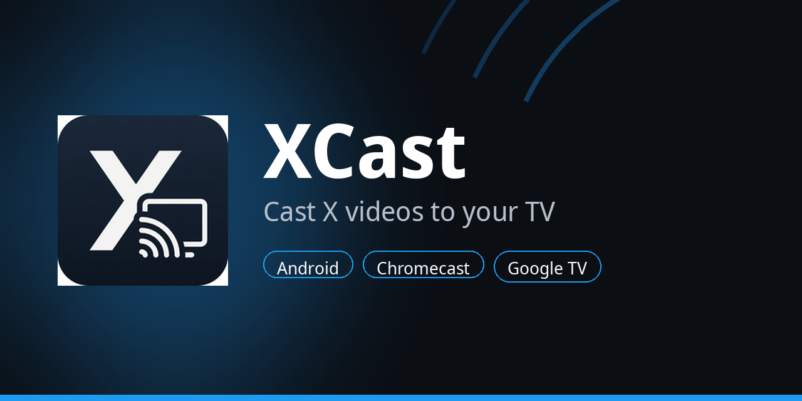
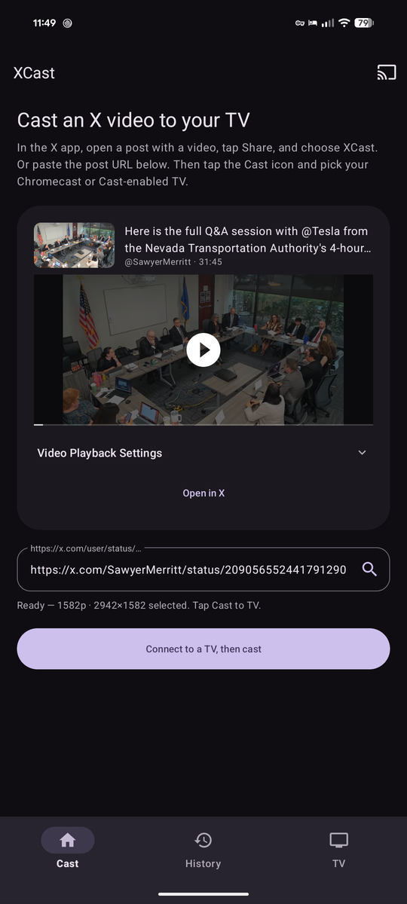
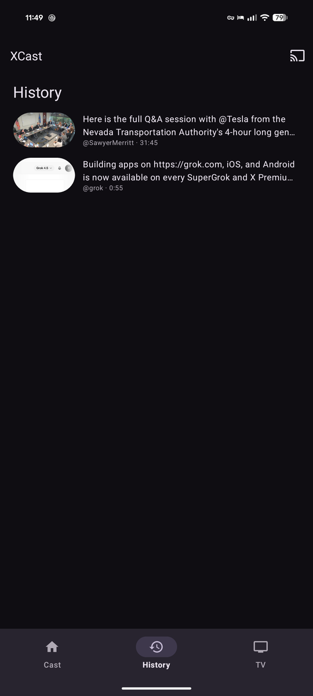
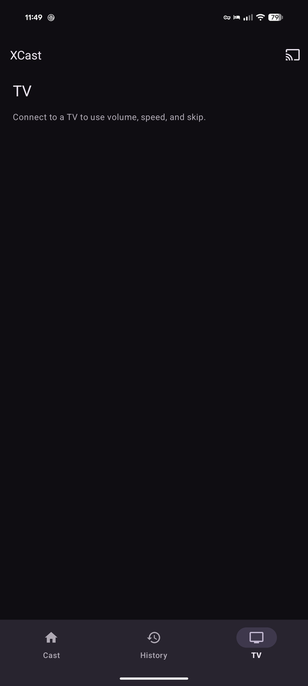

# XCast

<p align="center">
  
</p>

Android app that casts videos from [X](https://x.com) (Twitter) posts to a Chromecast or Cast-enabled TV using the [Google Cast SDK](https://developers.google.com/cast).

Share a video post from the X app, pick a Cast-safe resolution, and play it on the big screen. XCast is the remote: play/pause, scrub, captions, and chapters.

> **Unofficial.** XCast is an independent hobby project. It is **not** affiliated with, endorsed by, sponsored by, or associated with X Corp, Twitter, or any of their products. X, Twitter, Chromecast, and Google Cast are trademarks of their owners.

See [CHANGELOG.md](CHANGELOG.md) for release notes.

## Screenshots

<p align="center">
  
  
  
</p>

## Features

- **Share to XCast** from the X app (`text/plain` share and `x.com` / `twitter.com` links)
- Resolves a direct H.264 + AAC stream (no X API key)
- **LAN proxy** so Google TV / Sony Bravia can play Twitter MP4s (the TV fetches from the phone, not `video.twimg.com`)
- Defaults to the highest **Cast-safe** MP4, typically **1080p** when X publishes it
- Audio track and **closed captions / WebVTT** when X publishes them
- **Chapters** from timestamp lines in the post (`0:00 Intro`)
- Bottom tabs **Cast**, **History**, and **TV**, plus a YouTube Music-style **mini player**
- Mini player: artwork, play/pause, progress; tap for now-playing (scrubber, ±10s)
- **TV** tab: volume, mute, speed, skip, stop, chapter skip
- **Resume** from last position; **History** tab to re-open, pin, delete, or clear posts
- Thumbnail, duration, **Open in X**, on-phone **MP4 preview** before Cast
- Material You dynamic color, Cast intro overlay, keep-screen-on while casting

## Install

1. Download `XCast.apk` from the latest [GitHub Release](https://github.com/LinkofHyrule89/XCast/releases).
2. On your phone: Settings → allow install from the browser/Files app.
3. Phone and TV on the same Wi‑Fi. Google Play Services required.

Debug builds from CI are signed with the Android **debug** keystore so they sideload easily. They are not Play-store signed.

## Use

1. Open a **video** post in X.
2. Share → **XCast**, or paste `https://x.com/user/status/…` and tap the search icon.
3. XCast picks the sharpest Cast-safe MP4 (often 1080p). Open **Video Playback Settings** to change it.
4. Tap the Cast icon, pick your TV, then **Cast to TV**.
5. Control playback from the **mini player** (tap for now-playing) or the **TV** tab.

Phone and TV must be on the same Wi‑Fi. A VPN on the phone is fine as long as LAN is still reachable (do not send the TV a Tailscale `100.x` address).

Private posts, login-walled media, and some HLS-only clips may not resolve.

## Build

Requires JDK 17 and the Android SDK (compile SDK 36).

```bash
./gradlew assembleRelease
```

APK: `app/build/outputs/apk/release/app-release.apk`

Or open the folder in Android Studio.

GitHub Actions builds the APK on every push to `main` and publishes it when you push a tag:

```bash
git tag v1.2.1
git push origin v1.2.1
```

## How it works

1. A share/VIEW intent delivers the post URL.
2. The status ID is sent to FxTwitter / VxTwitter JSON endpoints.
3. Variants are ranked for Chromecast (prefer muxed 1080p or 720p MP4).
4. The phone serves the MP4 to the TV over HTTP/1.1 on the LAN so the receiver does not have to fetch `video.twimg.com` itself.
5. Google Cast **Default Media Receiver** (`CC1AD845`) plays that local URL.

Lookups and media URLs are restricted to HTTPS hosts on X/Twitter CDNs and the public lookup APIs. The TV is served cleartext HTTP only on the LAN, from the phone.

## Privacy

XCast does not require an X account or API token. Lookups go to third-party public tweet-embed APIs. No analytics SDK is bundled. Backup is disabled.

## License

MIT.

**Disclaimer:** XCast is fully unofficial. It is not affiliated with, endorsed by, sponsored by, or associated with X Corp, Twitter, Google, or any related companies. “X”, “Twitter”, “Chromecast”, and “Google Cast” are trademarks of their respective owners. Use at your own risk.
